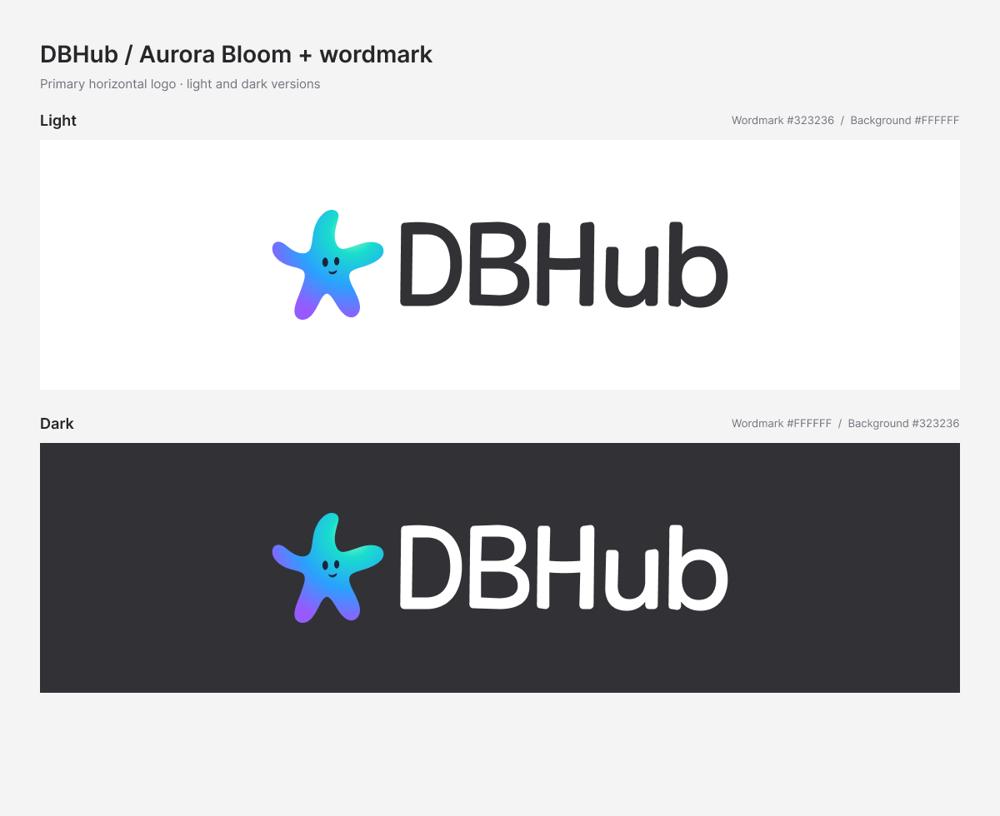

# DBHub branding

DBHub uses the Aurora Bloom starfish — a five-armed, smiling starfish filled with
a mint-to-violet radial gradient — beside an outlined wordmark in Zinc or white.
The gradient and the face remain part of the artwork at every size.

## Source assets

The complete logo set lives in [`assets/branding/`](assets/branding/). It contains
nine SVGs, the same nine assets as PNGs at three widths (27 files), two preview
sheets, a [`manifest.json`](assets/branding/manifest.json) recording Figma node
IDs and dimensions, and the original export notes. These are the source files
for the copies used by the website, workbench, and MCP bundle. The Figma sources
are recorded in [`README.txt`](assets/branding/README.txt).

| Use | Light background | Dark background |
| --- | --- | --- |
| Full logo | `svg/dbhub-logo-for-light-background.svg` | `svg/dbhub-logo-for-dark-background.svg` |
| Starfish icon | `svg/dbhub-icon-transparent.svg` | `svg/dbhub-icon-transparent.svg` |
| Wordmark | `svg/dbhub-wordmark-for-light-background.svg` | `svg/dbhub-wordmark-for-dark-background.svg` |

Names refer to the **background**: `for-light-background` files contain Zinc
lettering; `for-dark-background` files contain white lettering. The starfish is
identical in both, and the transparent icon works on either background. Files
named `white-background` or `zinc-background` (icon and full logo) bake in that
background and padding, for places that cannot guarantee the surface behind the
image.

Prefer SVG for the web. The lettering is outlined and does not require a font.
Every asset is also available as a PNG at 512, 1024, and 2048 pixels wide under
`png/512w/`, `png/1024w/`, and `png/2048w/`; heights preserve each aspect ratio.
Transparent PNGs keep their alpha channel; background variants are opaque.

## Logo placement

- Use the complete logo asset when displaying the symbol and wordmark together.
  Keep its original proportions, spacing, and alignment.
- Leave clear space of at least one quarter of the starfish's height on all sides.
  The transparent SVGs do not include this external clear space; provide it in
  the layout. The `white-background` and `zinc-background` variants include
  their own padding.
- The source starfish is 132 units tall, the lettering is 103 units tall, and the
  gap is 20 units. Both are vertically centered; the transparent full logo is
  547 × 132 units.
- Use the icon alone for favicons and app icons. Prefer the full logo where the
  name needs to be readable; use the icon if the available space is too small.
- Keep the artwork as exported. Do not stretch, rotate, recolor or flatten the
  gradient, alter the face, add shadows or outlines, or recreate the wordmark
  with live text.
- Give standalone logo images `alt="DBHub"`. For a linked home logo, label the
  link `DBHub home` and use empty image alt text to avoid duplicate announcements.

## Logo colors

The Aurora Bloom colors belong to the starfish artwork only. They are not
interface colors; the workbench and documentation keep the Zinc theme below.

| Color | Value | Role |
| --- | --- | --- |
| Aurora Bloom gradient | Radial: `#B2FCCB` (0%), `#19DECD` (25%), `#2AA1FE` (62%), `#955BFE` (100%) | Starfish fill |
| Ink | `#19253C` | Eyes and smile |
| Zinc | `#323236` | Lettering on light backgrounds |
| White | `#FFFFFF` | Lettering on dark backgrounds |

## Color theme

| Color | Value | Role |
| --- | --- | --- |
| Zinc | `#323236` / RGB `50, 50, 54` | Logo lettering on light backgrounds; primary actions and text |
| White | `#FFFFFF` / RGB `255, 255, 255` | Logo lettering on dark backgrounds; light canvas and inverse text |

The workbench expresses Zinc as `oklch(0.319 0.007 286)` and white as
`oklch(1 0 0)`. Zinc is rounded to three decimals; the exported SVG and PNG files
retain the exact source color. White and Zinc have approximately 12.76:1 contrast.

Use the semantic tokens in [`frontend/src/index.css`](frontend/src/index.css)
instead of adding raw colors to components:

| Role | Light mode | Dark mode |
| --- | --- | --- |
| Canvas | Zinc 50 | Zinc 950 |
| Working background / card | White | Zinc 900 |
| Popover | White | Zinc 800 |
| Sidebar | Zinc 100 | Zinc 900 |
| Foreground | Brand Zinc | Zinc 100 |
| Primary / primary foreground | Brand Zinc / white | White / brand Zinc |
| Muted surface | Zinc 50 | Zinc 800 |
| Hover and secondary surfaces | Zinc 100 | Zinc 800 |
| Selected surface | Zinc 200 | Brand Zinc |
| Muted text | `oklch(0.48 0.012 286)` | Zinc 400 |
| Focus ring | Zinc 600 | Zinc 400 |
| Divider | Black at 8% opacity | Zinc 800 |
| Subtle divider | Black at 5% opacity | `oklch(0.25 0.006 286)` |
| Input edge | `oklch(0.65 0.01 286)` | `oklch(0.56 0.012 286)` |
| Disabled surface / text | Zinc 100 / Zinc 500 | Zinc 800 / Zinc 400 |

Supporting Zinc shades come from Tailwind's existing OKLCH palette. Use
`bg-canvas` for the workspace, `bg-background` for an editable working surface,
`bg-card` for contained content, and `bg-popover` for floating content. Dark
surfaces become lighter as they rise above the canvas.

Use `bg-sidebar` for navigation, `bg-accent` for hover, and `bg-selection` with
`text-selection-foreground` for persistent selection. Hover and selection have
separate tokens so changing one does not erase the other. Primary hover and
pressed fills mix 90% and 80% of `--primary` with black in OKLCH; their labels
continue to use `--primary-foreground`.

Use `border-border` for layout separation, `border-border-subtle` for quiet row
separators, `border-input` for control edges, and `ring-ring` for keyboard focus.
Inputs and focus indicators have stronger contrast than decorative dividers.
Use the disabled surface/text pair instead of fading the entire button. Disabled
controls are exempt from normal text-contrast requirements; keep their labels
readable and preserve the native disabled state.

The workbench's `.dark` class controls the theme; logo variants follow that class.
Browser favicons use the transparent starfish icon, which reads on light and
dark browser chrome without a per-scheme variant. The SQL editor shares the input,
surface, selection, cursor, focus, and monospace font tokens.
Syntax tokens give keywords a restrained purple (`oklch(0.46 0.12 300)` in light
mode, `oklch(0.78 0.1 300)` in dark mode), strings emerald, and numbers blue.
Comments use muted text. Syntax accents reduce chroma where needed to stay
inside sRGB; light-mode string text also lowers lightness to pass contrast on
the selected surface. These editor accents stay readable against both the
working surface and the active line; they do not replace the Zinc interface palette.

### Typography

The workbench uses system sans-serif and monospace stacks without external font
requests. Font smoothing is set once on the body. Apply `tabular-nums` to counts,
timestamps, and timings; prose keeps the font's natural numerals. Use monospace
for SQL, tool and parameter identifiers, and results. Keep normal tracking on
monospace titles so identifiers retain their character spacing.

| Utility | Size / line height | Use |
| --- | --- | --- |
| `text-xs` | 12px / 1.5 | Compact badges and short metadata |
| `text-caption` | 13px / 1.5 | Supporting captions |
| `text-sm` | 14px / 1.5 | Dense controls, navigation, tables |
| `text-base` | 16px / 1.5 | Descriptions and mobile input text |
| `text-lg` | 18px / 1.4 | Small section titles |
| `text-xl` | 20px / 1.3 | Section titles |
| `text-2xl` | 24px / 1.25 | Large section titles |
| `text-3xl` | 28px / 1.2 | Occasional display emphasis |
| `text-page` | 24px / 1.25, weight 600, tracking −0.025em | Workbench page titles |
| `text-section` | 18px / 1.4, weight 600 | Sections within a page |
| `text-body` | 16px / 1.6 | Tool descriptions and explanatory copy |
| `text-label` | 14px / 1.5, weight 500 | Field labels and table headings |
| `text-code` | 14px / 1.6 | SQL and result values; pair with `font-mono` |

Sizes are expressed in rem so browser font preferences still apply. Keep inputs
at `text-base` below the `sm` breakpoint; use `sm:text-sm` for desktop density.
Use `max-w-prose text-pretty` on descriptions to keep reading columns near 65
characters. Page headings balance their lines; long identifiers and connection
values may wrap anywhere instead of escaping their container. Badges and timings
stay on one line.

Use `text-caption` for helper text, timestamps, and compact tool navigation.
Reserve 12px text for short badges, keyboard hints, and the collapsed source rail;
do not reduce labels below that floor. Collapsed source names use up to two lines
with a tooltip for the full value. Expanded source names and tool names wrap;
prefer breaks after underscores, periods, and hyphens without changing the identifier.
Other truncated identifiers and column headings expose the full value through a
title or detail view.

CodeMirror inherits the monospace stack and uses the code line height, with 16px
text below `sm` and 14px above it. Result rows measure their rendered height so
larger text preferences do not clip values or overlap rows.

### Navigation

The source rail is 96px collapsed and 224px expanded; the tool sidebar is 256px.
Keep their headers aligned at 64px, with the full logo at 128px wide. Source
context, Overview, and Tools form distinct groups. Use a leading border and the
selection surface for the active item without changing its font weight.

Navigation links have at least 44px targets, neutral inset focus outlines, and
`aria-current` for the active source or page. Read-only tools include an accessible
label alongside the lock icon. Source and tool lists scroll independently.
Below 768px, a modal drawer holds navigation; the workbench keeps the available
width. The drawer closes after navigation or Escape and returns focus to its
trigger. A skip link moves keyboard users directly to the main content.

### Query results

Use one scroll container for the table header and rows, with a sticky header and
row-number column. Share column widths across both; size from the column name and
up to 100 returned values, with a cap for long text. Keep row virtualization and
measure rendered heights so larger text settings remain usable.

Right-align columns containing JSON numbers (ignoring nulls) and use tabular
numerals. Keep strings unchanged, including decimal strings and identifiers with
leading zeroes; the result API does not provide database column types. Show nulls
as muted `NULL` and empty strings as `Empty string`. Render objects as JSON.

Every cell opens a keyboard-accessible inspector with the full value and a Copy
action. Preserve whitespace in strings and format JSON for reading and copying.
Keep filtering visible, search across all columns, and offer Clear filter when
there are no matches. Show row count and execution time beside the filter; put
the executed SQL in a disclosure below the table.

Result history uses a labeled tablist with one keyboard entry point. Left/Right
arrows wrap between tabs; Home/End jump to the first/last tab. Delete closes the
focused tab. Each tab has a separate, always-visible 44px close button; closing
an active tab focuses its next neighbor, or the previous neighbor at the end.
Closing the last result returns focus to the query inputs. Keep selection when
closing an inactive result.

Scroll the active tab and its close control into view horizontally without moving
the page. Allow native horizontal scrolling on touch; desktop overflow arrows
respect reduced motion. Label batch results with their statement position and
failed results with visible text. Only the first result in a batch displays the
request duration; other statements have no independently measured timing.

### Tool forms and controls

Use associated labels with the parameter name and a quiet Required or Optional
hint. Inputs and action buttons have a minimum 44px height; parameter inputs use
16px text. Connect descriptions and inline errors to their fields. Checkbox
labels include the gap and control in one clickable row. A required boolean can
be false; untouched optional parameters retain the tool default.

Validate on blur or Run, then clear an existing error as the user corrects it.
Keep numeric drafts intact while typing and report fractional integer values
instead of truncating them. Run remains available to explain missing values and
focus the first invalid field. Enter submits parameter forms; Cmd/Ctrl+Enter
runs from the SQL editor. Disable Run while a request is pending.

Use a primary Run action and a quiet, consistently sized Copy SQL action. Announce
copy success and display clipboard failures inline. Preserve parameter drafts
when synchronizing the URL, and use schema types when submitting values.

### Loading, empty, and error states

Keep existing result tabs, filters, and scroll positions available while a query
runs. Put a compact progress message above them; the first run uses the same
minimum-height area as the initial results prompt. Announce progress with a live
status. Skeletons reserve space while source, tool, and request pages load; stop
skeleton and spinner animation when reduced motion is requested.

Distinguish an unrun tool, a successful query returning no rows, affected-row
counts, and a failed query. Keep the executed SQL and elapsed time available for
empty results and failures. Errors combine an icon, a specific title, and the
original error detail. The Edit query action returns focus to the inputs; it
never executes a statement. Page-loading errors offer Try again for the read
request. Discard late responses after the user navigates to another tool.

### Spacing and surfaces

Spacing uses Tailwind's 4px base (`--spacing: 0.25rem`): 4–8px within controls,
12–16px between related controls, 24px between content groups, and 32–48px around
page content on desktop. On mobile, use 16px horizontal and 24px vertical page
padding; desktop pages use 32px horizontal and 40px vertical padding. Keep page
scrolling inside the main content pane and reserve its scrollbar gutter. Use the existing spacing utilities rather than per-component pixel
values. Do not change the root font size to make the interface denser.

`--radius` is the 8px control radius. It drives `rounded-sm` (4px), `rounded-md`
(6px), `rounded-lg` (8px), `rounded-xl` (12px), and `rounded-2xl` (16px).
Use small radii for navigation, 8px for controls, and 12–16px for larger panels.
When rounded surfaces nest closely, subtract the padding from the outer radius
for the inner radius. Fully rounded badges keep `rounded-full`.

`shadow-xs` uses the control elevation token; `shadow-sm` uses a three-layer
raised shadow; `shadow-md` and `shadow-lg` use the floating shadow. Dark-mode
elevations reduce to a quiet white ring. Keep actual borders on inputs and table
dividers, and avoid stacking an elevation ring with a second heavy border.

Source cards, parameter panels, and request lists use a 12px radius and
`shadow-sm` without an additional border. Keep tool and parameter descriptions
flat inside source cards, separated by spacing and rules. Required labels are
neutral metadata, not error badges. Dialogs use the floating shadow without a
second outer border or inset highlight. Retain real borders for inputs and result
grids. Fine section and list dividers use `--border-hairline` (1px, or 0.5px at
2× display density); keep input and focus outlines at their existing widths.

Default transitions are 150ms with an ease-out curve. Name the properties that
change, such as background color and box shadow; do not use `transition-all`.

Reserve red for destructive actions and errors, emerald for success, amber for
warnings, and blue for informational states. These functional colors remain
distinct from the Zinc interface palette and from the logo's gradient. Pair
status colors with text or icons. Check
body text at 4.5:1 contrast or better and visible focus indicators at 3:1 or better.

The documentation site's [`docs/docs.json`](docs/docs.json) uses Zinc for
`colors.primary` and `colors.dark`, and white for `colors.light` (dark-mode
emphasis). These fields require hex values in the
[Mintlify configuration](https://www.mintlify.com/docs/organize/settings-reference).
Keep DM Sans for documentation text and the existing system font stack in the
workbench; the custom logo lettering is artwork, not a UI typeface.

## Updating assets

1. Replace the files in `assets/branding/` with the new export, preserving names.
   If the export renames files, update the mapping in
   [`scripts/sync-branding.mjs`](scripts/sync-branding.mjs) and the table above.
2. Run `pnpm run sync:branding` to update all published copies.
3. If the full logo's dimensions change, update the `width` and `height` in
   [`frontend/src/components/Sidebar/Logo.tsx`](frontend/src/components/Sidebar/Logo.tsx).
4. If the palette changes, update the semantic theme and `docs/docs.json`, then
   update this guide.
5. Run `pnpm run build:frontend` and inspect light and dark logo variants,
   favicons, navigation, text, buttons, and focus states.

The sync script maintains the existing `docs/images/logo/` URLs used by the
README and documentation, the workbench's public assets, the two favicons, and
`mcpb/icon.png` (the 512-pixel transparent icon). `docs/images/logo/icon.svg`
and `icon-dark.svg` are kept as separate URLs but now hold the same transparent
icon. Do not edit these generated copies by hand; rerunning the command will
overwrite them.
