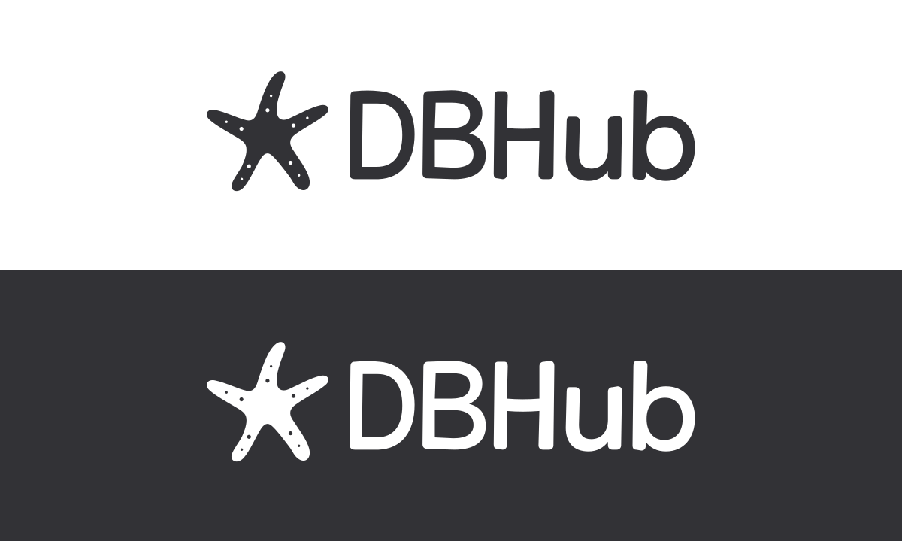

# DBHub branding

DBHub uses a starfish symbol and an outlined wordmark in Zinc and white. The
starfish's five arms and small cutouts remain part of the artwork at every size.

## Source assets

The complete logo pack lives in [`assets/branding/`](assets/branding/). It contains
six SVGs, 22 transparent PNGs, a preview, and the original export notes. These are
the source files for the copies used by the website, workbench, and MCP bundle.
The pack was exported on November 16, 2026; its Figma source is recorded in
[`README.txt`](assets/branding/README.txt).

| Use | Light background | Dark background |
| --- | --- | --- |
| Full logo | `svg/dbhub-logo-light.svg` | `svg/dbhub-logo-dark.svg` |
| Starfish icon | `svg/dbhub-icon-light.svg` | `svg/dbhub-icon-dark.svg` |
| Wordmark | `svg/dbhub-wordmark-light.svg` | `svg/dbhub-wordmark-dark.svg` |

Names refer to the **background**: `light` files contain Zinc artwork; `dark`
files contain white artwork. Prefer SVG for the web. The lettering is outlined
and does not require a font. PNG logos are available at 512, 1024, and 2048 pixels
wide; icons at 32–1024 pixels square; wordmarks at 512 and 1024 pixels wide.

## Logo placement

- Use the complete logo asset when displaying the symbol and wordmark together.
  Keep its original proportions, spacing, and optical alignment.
- Leave clear space of at least one quarter of the starfish's height on all sides.
  The SVG does not include this external clear space; provide it in the layout.
- The source starfish is 136 units tall, the lettering is 103 units tall, and the
  gap is 24 units. The starfish is optically raised by 5 units.
- Use the icon alone for favicons and app icons. Prefer the full logo where the
  name needs to be readable; use the icon if the available space is too small.
- Keep the artwork flat and monochrome. Do not stretch, rotate, recolor, add
  shadows, fill the cutouts, or recreate the wordmark with live text.
- Give standalone logo images `alt="DBHub"`. For a linked home logo, label the
  link `DBHub home` and use empty image alt text to avoid duplicate announcements.

## Color theme

| Color | Value | Role |
| --- | --- | --- |
| Zinc | `#323236` / RGB `50, 50, 54` | Logo on light backgrounds; primary actions and text |
| White | `#FFFFFF` / RGB `255, 255, 255` | Logo on dark backgrounds; light canvas and inverse text |

The workbench expresses Zinc as `oklch(0.319 0.007 286)` and white as
`oklch(1 0 0)`. Zinc is rounded to three decimals; the exported SVG and PNG files
retain the exact source color. White and Zinc have approximately 12.76:1 contrast.

Use the semantic tokens in [`frontend/src/index.css`](frontend/src/index.css)
instead of adding raw colors to components:

| Role | Light mode | Dark mode |
| --- | --- | --- |
| Canvas | Zinc 50 | Zinc 950 |
| Working background / card | White | Zinc 900 |
| Popover | White | Zinc 800 |
| Sidebar | Zinc 100 | Zinc 900 |
| Foreground | Brand Zinc | Zinc 100 |
| Primary / primary foreground | Brand Zinc / white | White / brand Zinc |
| Muted surface | Zinc 50 | Zinc 800 |
| Hover and secondary surfaces | Zinc 100 | Zinc 800 |
| Selected surface | Zinc 200 | Brand Zinc |
| Muted text | `oklch(0.48 0.012 286)` | Zinc 400 |
| Focus ring | Zinc 600 | Zinc 400 |
| Divider | Black at 8% opacity | Zinc 800 |
| Subtle divider | Black at 5% opacity | `oklch(0.25 0.006 286)` |
| Input edge | `oklch(0.65 0.01 286)` | `oklch(0.56 0.012 286)` |
| Disabled surface / text | Zinc 100 / Zinc 500 | Zinc 800 / Zinc 400 |

Supporting Zinc shades come from Tailwind's existing OKLCH palette. Use
`bg-canvas` for the workspace, `bg-background` for an editable working surface,
`bg-card` for contained content, and `bg-popover` for floating content. Dark
surfaces become lighter as they rise above the canvas.

Use `bg-sidebar` for navigation, `bg-accent` for hover, and `bg-selection` with
`text-selection-foreground` for persistent selection. Hover and selection have
separate tokens so changing one does not erase the other. Primary hover and
pressed fills mix 90% and 80% of `--primary` with black in OKLCH; their labels
continue to use `--primary-foreground`.

Use `border-border` for layout separation, `border-border-subtle` for quiet row
separators, `border-input` for control edges, and `ring-ring` for keyboard focus.
Inputs and focus indicators have stronger contrast than decorative dividers.
Use the disabled surface/text pair instead of fading the entire button. Disabled
controls are exempt from normal text-contrast requirements; keep their labels
readable and preserve the native disabled state.

The workbench's `.dark` class controls the theme; logo variants follow that class.
Browser favicons follow the OS color scheme. The SQL editor shares the input,
surface, selection, cursor, focus, and monospace font tokens.
Syntax tokens give keywords a restrained purple (`oklch(0.46 0.12 300)` in light
mode, `oklch(0.78 0.1 300)` in dark mode), strings emerald, and numbers blue.
Comments use muted text. Syntax accents reduce chroma where needed to stay
inside sRGB; light-mode string text also lowers lightness to pass contrast on
the selected surface. These editor accents stay readable against both the
working surface and the active line; they do not replace the Zinc brand palette.

### Type, spacing, radius, and elevation

The workbench uses system sans-serif and monospace stacks without external font
requests. Font smoothing is set once on the body. Apply `tabular-nums` to counts,
timestamps, and timings; prose keeps the font's natural numerals. Use monospace
for SQL, tool and parameter identifiers, and results. Keep normal tracking on
monospace titles so identifiers retain their character spacing.

| Utility | Size / line height | Use |
| --- | --- | --- |
| `text-xs` | 12px / 1.5 | Compact badges and short metadata |
| `text-caption` | 13px / 1.5 | Supporting captions |
| `text-sm` | 14px / 1.5 | Dense controls, navigation, tables |
| `text-base` | 16px / 1.5 | Descriptions and mobile input text |
| `text-lg` | 18px / 1.4 | Small section titles |
| `text-xl` | 20px / 1.3 | Section titles |
| `text-2xl` | 24px / 1.25 | Large section titles |
| `text-3xl` | 28px / 1.2 | Occasional display emphasis |
| `text-page` | 24px / 1.25, weight 600, tracking −0.025em | Workbench page titles |
| `text-section` | 18px / 1.4, weight 600 | Sections within a page |
| `text-body` | 16px / 1.6 | Tool descriptions and explanatory copy |
| `text-label` | 14px / 1.5, weight 500 | Field labels and table headings |
| `text-code` | 14px / 1.6 | SQL and result values; pair with `font-mono` |

Sizes are expressed in rem so browser font preferences still apply. Keep inputs
at `text-base` below the `sm` breakpoint; use `sm:text-sm` for desktop density.
Use `max-w-prose text-pretty` on descriptions to keep reading columns near 65
characters. Page headings balance their lines; long identifiers and connection
values may wrap anywhere instead of escaping their container. Badges and timings
stay on one line.

Use `text-caption` for helper text, timestamps, and compact tool navigation.
Reserve 12px text for short badges, keyboard hints, and the collapsed source rail;
do not reduce labels below that floor. Collapsed source names truncate on one line
with a tooltip. Other truncated identifiers and column headings expose the full
value through a title or detail view.

CodeMirror inherits the monospace stack and uses the code line height, with 16px
text below `sm` and 14px above it. Result rows measure their rendered height so
larger text preferences do not clip values or overlap rows.

Spacing uses Tailwind's 4px base (`--spacing: 0.25rem`): 4–8px within controls,
12–16px between related controls, 24px between content groups, and 32–48px around
page content. Use the existing spacing utilities rather than per-component pixel
values. Do not change the root font size to make the interface denser.

`--radius` is the 8px control radius. It drives `rounded-sm` (4px), `rounded-md`
(6px), `rounded-lg` (8px), `rounded-xl` (12px), and `rounded-2xl` (16px).
Use small radii for navigation, 8px for controls, and 12–16px for larger panels.
When rounded surfaces nest closely, subtract the padding from the outer radius
for the inner radius. Fully rounded badges keep `rounded-full`.

`shadow-xs` uses the control elevation token; `shadow-sm` uses a three-layer
raised shadow; `shadow-md` and `shadow-lg` use the floating shadow. Dark-mode
elevations reduce to a quiet white ring. Keep actual borders on inputs and table
dividers, and avoid stacking an elevation ring with a second heavy border.

Default transitions are 150ms with an ease-out curve. Name the properties that
change, such as background color and box shadow; do not use `transition-all`.

Reserve red for destructive actions and errors, emerald for success, amber for
warnings, and blue for informational states. These functional colors remain
distinct from the monochrome brand. Pair status colors with text or icons. Check
body text at 4.5:1 contrast or better and visible focus indicators at 3:1 or better.

The documentation site's [`docs/docs.json`](docs/docs.json) uses Zinc for
`colors.primary` and `colors.dark`, and white for `colors.light` (dark-mode
emphasis). These fields require hex values in the
[Mintlify configuration](https://www.mintlify.com/docs/organize/settings-reference).
Keep DM Sans for documentation text and the existing system font stack in the
workbench; the custom logo lettering is artwork, not a UI typeface.

## Updating assets

1. Replace the files in `assets/branding/` with the new export, preserving names.
2. Run `pnpm run sync:branding` to update all published copies.
3. If the palette changes, update the semantic theme and `docs/docs.json`, then
   update this guide.
4. Run `pnpm run build:frontend` and inspect light and dark logo variants,
   favicons, navigation, text, buttons, and focus states.

The sync script maintains the existing `docs/images/logo/` URLs used by the
README and documentation, the workbench's public assets, and `mcpb/icon.png`
(the 512-pixel Zinc icon). It also adds dark-mode styling to the two favicons
without changing the source SVG geometry. Do not edit these generated copies by
hand; rerunning the command will overwrite them.
